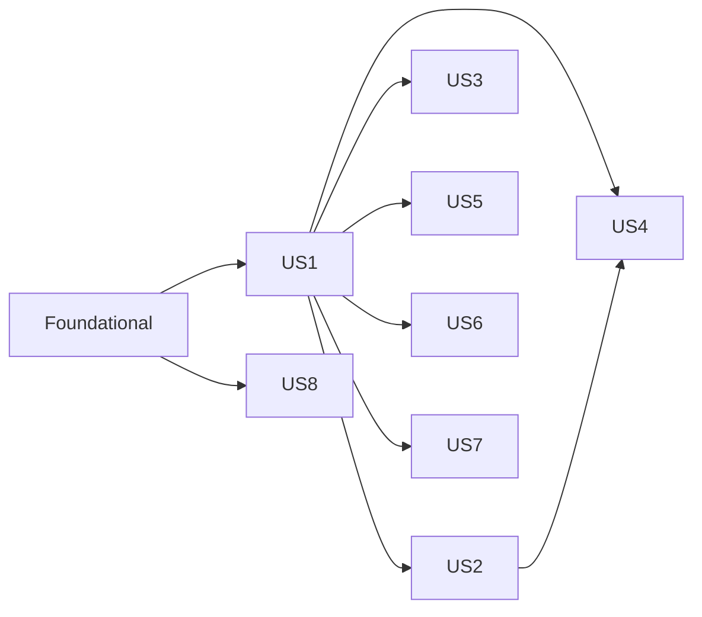

# Tasks: Document Upload and Management

**Input**: Design documents from `/specs/001-document-upload-management/`
**Prerequisites**: plan.md, spec.md, research.md, data-model.md, contracts/, quickstart.md

**Tests**: Included. Constitution Principle IV requires offline automated tests for new service
logic, including allowed and denied authorization cases.

**Organization**: Tasks are grouped by user story so each story can be implemented and tested
independently.

## Format: `[ID] [P?] [Story] Description`

- **[P]**: Can run in parallel (different files, no dependencies on incomplete tasks)
- **[Story]**: User story the task belongs to (US1–US8)
- Paths are relative to the repository root

## Path Conventions

- Web app: `ContosoDashboard/` (Models, Data, Services, Pages, Shared)
- Tests: `ContosoDashboard.Tests/`

---

## Phase 1: Setup (Shared Infrastructure)

**Purpose**: Test project, configuration, and repository hygiene

- [ ] T001 Create xUnit test project `ContosoDashboard.Tests/ContosoDashboard.Tests.csproj` targeting `net10.0` with packages `xunit`, `xunit.runner.visualstudio`, `Microsoft.NET.Test.Sdk`, `Microsoft.Data.Sqlite`, and a `ProjectReference` to `ContosoDashboard/ContosoDashboard.csproj`
- [ ] T002 [P] Add `"FileStorage": { "RootPath": "AppData/uploads" }` to `ContosoDashboard/appsettings.json`
- [ ] T003 [P] Add `ContosoDashboard/AppData/` to `.gitignore`

---

## Phase 2: Foundational (Blocking Prerequisites)

**Purpose**: Full schema (one DB reset under `EnsureCreated()`), storage/scan abstractions, the
service skeleton with the shared access filter, and test helpers

**⚠️ CRITICAL**: No user story work can begin until this phase is complete

- [ ] T004 [P] Create `DocumentCategories` static class in `ContosoDashboard/Models/DocumentCategories.cs` with `All` = Project Documents, Team Resources, Personal Files, Reports, Presentations, Other; `AllowedExtensions` map (.pdf, .doc, .docx, .xls, .xlsx, .ppt, .pptx, .txt, .jpg, .jpeg, .png → MIME per data-model.md); `PreviewableTypes` = application/pdf, image/jpeg, image/png; `MaxFileSizeBytes = 26_214_400`
- [ ] T005 [P] Create `Document` entity in `ContosoDashboard/Models/Document.cs`: `DocumentId` int PK; `Title` required MaxLength(255); `Description` MaxLength(2000) nullable; `Category` required MaxLength(50); `ProjectId` int? FK; `UploadedByUserId` int required FK; `OriginalFileName` required MaxLength(255); `FilePath` required MaxLength(500); `FileType` required MaxLength(255); `FileSizeBytes` long; `UploadedDate`/`UpdatedDate` DateTime UTC; navigations to User, Project, Tags, Shares, TaskDocuments
- [ ] T006 [P] Create `DocumentTag` entity in `ContosoDashboard/Models/DocumentTag.cs`: `DocumentTagId` PK; `DocumentId` FK; `Tag` required MaxLength(50) (stored trimmed, lower-cased)
- [ ] T007 [P] Create `DocumentShare` entity in `ContosoDashboard/Models/DocumentShare.cs`: `DocumentShareId` PK; `DocumentId` FK; `SharedWithUserId` int? FK; `SharedWithProjectId` int? FK (exactly one set); `SharedByUserId` int FK; `SharedDate` DateTime UTC
- [ ] T008 [P] Create `TaskDocument` entity in `ContosoDashboard/Models/TaskDocument.cs`: composite key (`TaskId`, `DocumentId`); `AttachedByUserId` FK; `AttachedDate` DateTime UTC
- [ ] T009 [P] Create `DocumentActivity` entity in `ContosoDashboard/Models/DocumentActivity.cs`: `DocumentActivityId` PK; `DocumentId` int (no FK); `DocumentTitle` MaxLength(255); `FileType` MaxLength(255); `UserId` FK; `Action` MaxLength(30) (Upload, Download, EditMetadata, ReplaceFile, Delete, Share, RevokeShare); `Timestamp` DateTime UTC
- [ ] T010 [P] Append `DocumentShared` and `DocumentAdded` to the end of `NotificationType` in `ContosoDashboard/Models/Notification.cs` (existing values unchanged)
- [ ] T011 Register `DbSet`s for the five new entities in `ContosoDashboard/Data/ApplicationDbContext.cs` and configure relationships and indexes per data-model.md: Document→User/Project Restrict; Tags/Shares/TaskDocuments Cascade; unique `Document.FilePath`; indexes on `Document(UploadedByUserId)`, `(ProjectId)`, `(UploadedDate)`; unique (`DocumentId`,`Tag`); indexes `DocumentShare(SharedWithUserId)`, `(SharedWithProjectId)` with unique per-document pairs; `TaskDocument` composite key; `DocumentActivity` indexes (`Action`,`Timestamp`), `UserId`, `DocumentId` (depends on T005–T009)
- [ ] T012 [P] Create `IFileStorageService` in `ContosoDashboard/Services/Storage/IFileStorageService.cs` per contracts/service-interfaces.md (`UploadAsync`, `DeleteAsync`, `DownloadAsync`, `GetUrlAsync`)
- [ ] T013 Implement `LocalFileStorageService` in `ContosoDashboard/Services/Storage/LocalFileStorageService.cs`: root from `FileStorage:RootPath` relative to content root; create directories; resolve full path and reject keys escaping the root; `DeleteAsync` no-op if missing; `GetUrlAsync` returns `/documents/{id}/download` style route supplied by caller key mapping (depends on T012)
- [ ] T014 [P] Create `IFileScanService` and `FileScanResult` record in `ContosoDashboard/Services/Scanning/IFileScanService.cs`
- [ ] T015 Implement `ContentTypeScanService` in `ContosoDashboard/Services/Scanning/ContentTypeScanService.cs`: extension allow-list from `DocumentCategories.AllowedExtensions`; signature checks (PDF `%PDF`, PNG, JPEG `FF D8 FF`, OOXML ZIP `50 4B 03 04`, OLE `D0 CF 11 E0 A1 B1 1A E1`, `.txt` no NUL in first 8 KB); return MIME from extension; restore stream position (depends on T004, T014)
- [ ] T016 Create `IDocumentService` interface and DTOs (`DocumentUploadRequest`, `DocumentQuery`, `DocumentListItem`, `DocumentDetails`, `DocumentFile`, `UploadResult`, `OperationResult`, `DocumentShareInfo`) in `ContosoDashboard/Services/DocumentService.cs` per contracts/service-interfaces.md, plus `DocumentService` class with constructor (context, storage, scan, notification service, logger) and private helpers: `AccessibleDocuments(userId)` IQueryable access filter (Administrator; uploader; project member or manager; direct share; team share via current project membership; project TeamLead over uploader's projects), `CanManage`/`CanDelete` checks, `ToListItem` projection with `CanEdit`/`CanDelete`/`CanShare`/`IsPreviewable`, and `LogActivityAsync` (depends on T011, T012, T014)
- [ ] T017 Register `IFileStorageService`→`LocalFileStorageService` (singleton), `IFileScanService`→`ContentTypeScanService` (singleton), and `IDocumentService`→`DocumentService` (scoped) in `ContosoDashboard/Program.cs` (depends on T013, T015, T016)
- [ ] T018 [P] Create test helper `ContosoDashboard.Tests/TestDb.cs`: open SQLite `DataSource=:memory:` connection, build `ApplicationDbContext`, `EnsureCreated()`, seed users for each role plus projects with members (including a `ProjectMember.Role = "TeamLead"`), and a temp-directory `LocalFileStorageService` factory with cleanup (depends on T001, T011, T013)
- [ ] T019 [P] Write `ContosoDashboard.Tests/LocalFileStorageServiceTests.cs`: upload/download round-trip, delete missing is no-op, keys with `..` or absolute paths are rejected (depends on T018)
- [ ] T020 [P] Write `ContosoDashboard.Tests/ContentTypeScanServiceTests.cs`: each allowed type with valid signature passes; renamed executable (`MZ` header as `.pdf`) rejected; `.exe` and `.docm` rejected; text with NUL rejected (depends on T015, T001)
- [ ] T021 Write `ContosoDashboard.Tests/DocumentAuthorizationTests.cs` with the view-access matrix for `AccessibleDocuments` via public query methods as they are added (start with uploader-only and Administrator cases; extend in later stories) (depends on T016, T018)

**Checkpoint**: Schema, abstractions, access filter, and test harness ready; `dotnet build` and `dotnet test` pass

---

## Phase 3: User Story 1 - Upload and view my documents (Priority: P1) 🎯 MVP

**Goal**: Users upload one or more files with metadata, see them in My Documents (sort/filter), and download them

**Independent Test**: Log in, upload a supported file with title and category, see it in My Documents with correct details, download identical content; oversized/invalid files are rejected and nothing is stored

### Tests for User Story 1 ⚠️

> Write these tests first and confirm they fail before implementation

- [ ] T022 [P] [US1] Write `ContosoDashboard.Tests/DocumentUploadTests.cs`: valid upload stores file under `{userId}/personal/{guid}.{ext}` and row with metadata; title defaults rule enforced (empty title rejected); missing category rejected; category not in list rejected; >25 MB rejected; scan rejection stores nothing; DB failure after file save deletes the file; storage failure creates no row; uploading to a project the user is not a member of is rejected; `Upload` activity logged
- [ ] T023 [P] [US1] Add tests to `ContosoDashboard.Tests/DocumentAuthorizationTests.cs`: `GetMyDocumentsAsync` returns only own uploads with sort (title, date, category, size) and filters (category, project, date range); `OpenForDownloadAsync` returns file for uploader/Administrator and null for an unrelated user; download logs `Download` activity

### Implementation for User Story 1

- [ ] T024 [US1] Implement `UploadAsync` in `ContosoDashboard/Services/DocumentService.cs`: validate title (trimmed, ≤255), category ∈ `DocumentCategories.All`, size 1..25 MB; scan via `IFileScanService`; authorize `ProjectId` (member or manager); generate key `{userId}/{projectId|personal}/{Guid}.{ext}`; save file; insert Document + normalized tags in a transaction; on DB failure delete file; log `Upload` (depends on T016)
- [ ] T025 [US1] Implement `GetMyDocumentsAsync` (server-side filter/sort per `DocumentQuery`) and `GetByIdAsync` in `ContosoDashboard/Services/DocumentService.cs` (depends on T024)
- [ ] T026 [US1] Implement `OpenForDownloadAsync` in `ContosoDashboard/Services/DocumentService.cs`: access check via `AccessibleDocuments`, return `DocumentFile` stream + content type + original name, `previewOnly` returns null for non-previewable types, log `Download` (depends on T016)
- [ ] T027 [US1] Map `GET /documents/{documentId:int}/download` in `ContosoDashboard/Program.cs` with `.RequireAuthorization()`; read user id from `NameIdentifier`; return `Results.File(..., fileDownloadName: OriginalFileName)` or `Results.NotFound()` per contracts/http-endpoints.md (depends on T026, T017)
- [ ] T028 [P] [US1] Create `ContosoDashboard/Shared/Documents/DocumentTable.razor`: columns title, category, upload date, size (human-readable), project; sortable headers raising `OnSort`; Download link to `/documents/{id}/download`; action buttons rendered from `CanEdit`/`CanDelete`/`CanShare`/`IsPreviewable` flags via callbacks
- [ ] T029 [US1] Create `ContosoDashboard/Shared/Documents/DocumentUploadModal.razor`: `InputFile multiple` with `@key` reset; shared fields (category, project from user's projects, tags, description) prefill each selected file row; per-file title defaulting to file name without extension; capture name/size/type before reading; chunked copy of `OpenReadStream(25 MB)` into `MemoryStream` with per-file progress bar; call `UploadAsync` per file; per-file success/error messages; parameters `FixedProjectId?`, `TaskId?`, `OnUploaded` (depends on T024)
- [ ] T030 [US1] Create `ContosoDashboard/Pages/Documents.razor` at `@page "/documents"` with `[Authorize]`: My Documents tab using `DocumentTable`, category/project/date-range filters, sort state, Upload button opening `DocumentUploadModal` (≤3 clicks to upload) (depends on T025, T028, T029)
- [ ] T031 [US1] Add "Documents" link to `ContosoDashboard/Shared/NavMenu.razor`

**Checkpoint**: US1 fully functional and testable on its own (MVP)

---

## Phase 4: User Story 2 - Project documents for team members (Priority: P2)

**Goal**: Project members see, download, and upload project documents; members are notified of new project documents

**Independent Test**: Member A uploads to Project X; member B sees and downloads it on the project page and gets a notification; non-member gets 404

### Tests for User Story 2 ⚠️

- [ ] T032 [P] [US2] Add tests to `ContosoDashboard.Tests/DocumentAuthorizationTests.cs`: `GetProjectDocumentsAsync` returns documents to project members and the project manager, empty/null for non-members; `OpenForDownloadAsync` allowed for members, denied for non-members; access lost after member removal
- [ ] T033 [P] [US2] Add tests to `ContosoDashboard.Tests/DocumentUploadTests.cs`: project upload creates `DocumentAdded` notifications for every other member and the manager, none for the uploader

### Implementation for User Story 2

- [ ] T034 [US2] Implement `GetProjectDocumentsAsync` in `ContosoDashboard/Services/DocumentService.cs` (requires requester to be member or manager; Administrator allowed) (depends on T025)
- [ ] T035 [US2] Extend `UploadAsync` in `ContosoDashboard/Services/DocumentService.cs` to send `DocumentAdded` notifications via `INotificationService` to project members and manager excluding the uploader (depends on T024)
- [ ] T036 [US2] Add a Documents section to `ContosoDashboard/Pages/ProjectDetails.razor`: list via `DocumentTable`, Upload button opening `DocumentUploadModal` with `FixedProjectId` (depends on T034, T028, T029)

**Checkpoint**: US1 and US2 work independently

---

## Phase 5: User Story 3 - Search documents (Priority: P2)

**Goal**: Search by title, description, tags, uploader name, project; results limited to accessible documents

**Independent Test**: Documents with distinct tags uploaded by different users; search returns only matching accessible documents; empty state shown for no matches

### Tests for User Story 3 ⚠️

- [ ] T037 [P] [US3] Write `ContosoDashboard.Tests/DocumentSearchTests.cs`: matches on each field (title, description, tag, uploader display name, project name); inaccessible matches excluded; blank term returns empty list

### Implementation for User Story 3

- [ ] T038 [US3] Implement `SearchAsync` in `ContosoDashboard/Services/DocumentService.cs` using `EF.Functions.Like` over title, description, tags, uploader `DisplayName`, project name, applied on top of `AccessibleDocuments` (depends on T016)
- [ ] T039 [US3] Add a Search tab to `ContosoDashboard/Pages/Documents.razor` with input, results via `DocumentTable`, and "No documents found" empty state (depends on T038, T030)

**Checkpoint**: US1–US3 work independently

---

## Phase 6: User Story 4 - Manage my documents (Priority: P3)

**Goal**: Edit metadata, replace file, and permanently delete with role-based permissions

**Independent Test**: Uploader edits, replaces, deletes; Project Manager deletes project document; Administrator edits/deletes any; unrelated user is denied

### Tests for User Story 4 ⚠️

- [ ] T040 [P] [US4] Write `ContosoDashboard.Tests/DocumentManagementTests.cs`: allow/deny matrix — edit metadata (uploader, project TeamLead, Administrator allowed; others denied); replace file (uploader only; old file removed, size/type/UpdatedDate updated); delete (uploader, project manager, project TeamLead, Administrator allowed; others denied); delete removes file, tags, shares, task attachments but keeps activity rows; activities `EditMetadata`, `ReplaceFile`, `Delete` logged

### Implementation for User Story 4

- [ ] T041 [US4] Implement `UpdateMetadataAsync` in `ContosoDashboard/Services/DocumentService.cs` (validate title/category, replace tag set, set `UpdatedDate`, log) (depends on T016)
- [ ] T042 [US4] Implement `ReplaceFileAsync` in `ContosoDashboard/Services/DocumentService.cs` (uploader only; scan + size check; save new key; update row; delete old file after commit; log) (depends on T024)
- [ ] T043 [US4] Implement `DeleteAsync` in `ContosoDashboard/Services/DocumentService.cs` (permission check; remove row in transaction with cascades; delete file after commit; log with title snapshot) (depends on T016)
- [ ] T044 [P] [US4] Create `ContosoDashboard/Shared/Documents/DocumentEditModal.razor`: edit title, description, category, tags; Replace file section (shown only when user is uploader) using the MemoryStream pattern
- [ ] T045 [US4] Wire Edit and Delete actions (with confirmation dialog) into `ContosoDashboard/Pages/Documents.razor` and `ContosoDashboard/Pages/ProjectDetails.razor`, refreshing lists after success (depends on T041–T044, T036)

**Checkpoint**: US1–US4 work independently

---

## Phase 7: User Story 5 - Share documents (Priority: P3)

**Goal**: Owners share with users or project teams; recipients are notified and see "Shared with Me"; owners/Administrators can revoke

**Independent Test**: A shares with B → B notified and can download; A revokes → B gets 404; C never has access

### Tests for User Story 5 ⚠️

- [ ] T046 [P] [US5] Write `ContosoDashboard.Tests/DocumentSharingTests.cs`: share with user grants access and creates `DocumentShared` notification; team share grants access to current members/manager only (new joiner gains, removed member loses); sharing with self or duplicate rejected without extra notification; team share only to projects the sharer belongs to; non-owner cannot share; revoke by owner or Administrator removes access immediately with no notification; `Share`/`RevokeShare` logged; `GetSharedWithMeAsync` lists direct and team shares

### Implementation for User Story 5

- [ ] T047 [US5] Implement `ShareWithUserAsync`, `ShareWithProjectTeamAsync`, `RevokeShareAsync`, `GetSharesAsync`, and `GetSharedWithMeAsync` in `ContosoDashboard/Services/DocumentService.cs` with notifications and activity logging (depends on T016)
- [ ] T048 [P] [US5] Create `ContosoDashboard/Shared/Documents/DocumentShareModal.razor`: choose user or one of the owner's projects; list current shares with Revoke buttons
- [ ] T049 [US5] Add Shared with Me tab and Share action to `ContosoDashboard/Pages/Documents.razor` (depends on T047, T048, T030)

**Checkpoint**: US1–US5 work independently

---

## Phase 8: User Story 6 - Task and dashboard integration (Priority: P4)

**Goal**: View/attach/upload documents from tasks (project auto-assigned); dashboard Recent Documents widget and document count

**Independent Test**: Upload from a task in Project X → attached and associated with X; dashboard shows last 5 uploads and correct count

### Tests for User Story 6 ⚠️

- [ ] T050 [P] [US6] Write `ContosoDashboard.Tests/DocumentTaskIntegrationTests.cs`: upload with `TaskId` sets document `ProjectId` to the task's project and creates `TaskDocument`; attaching a document from a different project is rejected; user without task access is rejected; `GetTaskDocumentsAsync` filtered by access; `GetRecentAsync` returns 5 newest; `GetUploadedCountAsync` correct

### Implementation for User Story 6

- [ ] T051 [US6] Implement `GetTaskDocumentsAsync`, `AttachToTaskAsync`, `TaskId` handling in `UploadAsync`, `GetRecentAsync`, and `GetUploadedCountAsync` in `ContosoDashboard/Services/DocumentService.cs` (task access = assigned user, creator, project member/manager, or Administrator) (depends on T024)
- [ ] T052 [US6] Add `TotalDocuments` to `DashboardSummary` and populate it in `ContosoDashboard/Services/DashboardService.cs` (depends on T011)
- [ ] T053 [US6] Add a per-task Documents panel to `ContosoDashboard/Pages/Tasks.razor`: list, attach existing accessible project document, upload via `DocumentUploadModal` with `TaskId` (depends on T051, T029)
- [ ] T054 [US6] Add Recent Documents widget and Documents summary card to `ContosoDashboard/Pages/Index.razor` (depends on T051, T052)

**Checkpoint**: US1–US6 work independently

---

## Phase 9: User Story 7 - Preview documents (Priority: P4)

**Goal**: Preview PDF/JPEG/PNG in the browser (new tab); other types offer download only

**Independent Test**: Preview PDF and PNG inline in a new tab; DOCX shows only Download; unauthorized preview returns 404

### Tests for User Story 7 ⚠️

- [ ] T055 [P] [US7] Add tests to `ContosoDashboard.Tests/DocumentAuthorizationTests.cs`: `OpenForDownloadAsync(previewOnly: true)` returns content for PDF/JPEG/PNG and null for DOCX/TXT; denied for unauthorized users

### Implementation for User Story 7

- [ ] T056 [US7] Map `GET /documents/{documentId:int}/preview` in `ContosoDashboard/Program.cs` with `.RequireAuthorization()`, returning inline file (no download name) or 404 per contracts/http-endpoints.md (depends on T026, T027)
- [ ] T057 [US7] Add Preview link (`target="_blank" rel="noopener"`, shown only when `IsPreviewable`) to `ContosoDashboard/Shared/Documents/DocumentTable.razor` (depends on T028)

**Checkpoint**: US1–US7 work independently

---

## Phase 10: User Story 8 - Activity log and administrator reports (Priority: P5)

**Goal**: Administrators see date-filtered reports: most uploaded types, most active uploaders, most-downloaded documents, downloads per user

**Independent Test**: Perform upload/download/share/delete; Administrator report reflects them for the date range; non-admins denied

### Tests for User Story 8 ⚠️

- [ ] T058 [P] [US8] Write `ContosoDashboard.Tests/DocumentReportServiceTests.cs`: aggregates correct for seeded activity rows; date range excludes outside rows; deleted documents still counted via snapshot; non-Administrator gets null

### Implementation for User Story 8

- [ ] T059 [US8] Create `IDocumentReportService`, `DocumentReport` DTO, and `DocumentReportService` in `ContosoDashboard/Services/DocumentReportService.cs` aggregating `DocumentActivity` (Upload by `FileType`, Upload by user, Download by document, Download by user) within `[fromUtc, toUtc]`; register as scoped in `ContosoDashboard/Program.cs` (depends on T011)
- [ ] T060 [US8] Create `ContosoDashboard/Pages/DocumentReports.razor` at `@page "/documents/reports"` with `[Authorize(Policy = "Administrator")]`, date range inputs (default last 30 days), and four tables (depends on T059)
- [ ] T061 [US8] Add "Document Reports" link visible only to Administrators in `ContosoDashboard/Shared/NavMenu.razor` (depends on T031)

**Checkpoint**: All user stories independently functional

---

## Phase 11: Polish & Cross-Cutting Concerns

- [ ] T062 [P] Update `README.md`: Documents feature and pages, storage location `AppData/uploads`, one-time `ContosoDashboard.db` reset, offline scan limitation, allowed types/size, how to run `dotnet test`
- [ ] T063 [P] Update `StakeholderDocs/document-upload-and-management-feature.md` "Database Setup Requirements" to reference SQLite (`rm ContosoDashboard.db`) instead of LocalDB
- [ ] T064 Verify `dotnet build ContosoDashboard/ContosoDashboard.csproj` has 0 errors and no new warnings, and `dotnet test ContosoDashboard.Tests/ContosoDashboard.Tests.csproj` passes
- [ ] T065 Security review of `ContosoDashboard/Program.cs` and `ContosoDashboard/Services/DocumentService.cs`: every public method enforces authorization, endpoints return 404 for unauthorized, `AppData` not served statically, security headers unchanged
- [ ] T066 Run all scenarios in `specs/001-document-upload-management/quickstart.md` and record results

---

## Dependencies & Execution Order

### Phase Dependencies

- **Setup (Phase 1)**: none
- **Foundational (Phase 2)**: after Setup; blocks all stories
- **US1 (Phase 3)**: after Foundational — MVP
- **US2, US3 (Phases 4–5)**: after Foundational; reuse US1 components (`DocumentTable`, `DocumentUploadModal`, `Documents.razor`) — implement after US1 or build those components first
- **US4, US5 (Phases 6–7)**: after Foundational; UI wiring touches `Documents.razor` (US1) and `ProjectDetails.razor` (US2)
- **US6 (Phase 8)**: after US1 (upload modal, `UploadAsync`)
- **US7 (Phase 9)**: after US1 (download endpoint, table)
- **US8 (Phase 10)**: after Foundational (activity log); meaningful data after US1/US5
- **Polish (Phase 11)**: after desired stories

### Story Dependency Graph

### Within Each Story

- Tests first (must fail) → service methods → endpoints → UI → wiring
- `ContosoDashboard/Services/DocumentService.cs` is shared: its tasks are sequential (no [P])

## Parallel Examples

- **Phase 2**: T004–T010 (separate model files), T012, T014 in parallel; then T011, T013, T015; T019/T020 in parallel after T018
- **US1**: T022 + T023 (tests) and T028 (table component) in parallel; T024→T025→T026 sequential (same file)
- **US4**: T040 and T044 in parallel with service work T041–T043
- **US5**: T046 and T048 in parallel with T047
- **Across stories** (after US1): US3 (search tab) and US7 (preview) touch different files except `Documents.razor`/`DocumentTable.razor`; US8 is fully independent of US2–US7

## Implementation Strategy

### MVP First (User Story 1 only)

1. Phase 1 → Phase 2 → Phase 3
2. Stop and validate with quickstart US1 rows and `dotnet test`
3. Demo: upload, list, sort/filter, download

### Incremental Delivery

1. MVP (US1) → US2 (project docs) → US3 (search) → US4 (manage) → US5 (share) → US6 (tasks/dashboard) → US7 (preview) → US8 (reports)
2. After each story: build, run tests, run that story's quickstart rows

### Notes

- Delete `ContosoDashboard/ContosoDashboard.db` once after Phase 2 (schema change under `EnsureCreated()`)
- Commit after each task or logical group

---

## Phase 12: Convergence

- [ ] T067 Strengthen OOXML validation in `ContosoDashboard/Services/Scanning/ContentTypeScanService.cs` so `.docx/.xlsx/.pptx` require a ZIP containing `[Content_Types].xml` and the matching `word/`, `xl/`, or `ppt/` part (a plain ZIP renamed to `.docx` must be rejected), with tests in `ContosoDashboard.Tests/ContentTypeScanServiceTests.cs` per FR-008 / research R4 (partial)
- [ ] T068 Include project managers in Team Lead scope in `ContosoDashboard/Services/DocumentService.cs` (`GetUserContextAsync` led-user set must add `Project.ProjectManagerId` of projects where the user holds the TeamLead role), with allow/deny tests in `ContosoDashboard.Tests/DocumentManagementTests.cs` per FR-023 / research R6 (partial)
- [ ] T069 Reconcile `LocalFileStorageService.GetUrlAsync` (currently throws `NotSupportedException`) with contracts/service-interfaces.md ("local: app download route"): make the method's behavior and the contract agree and cover it in `ContosoDashboard.Tests/LocalFileStorageServiceTests.cs` per contracts/service-interfaces.md (contradicts)
- [ ] T070 Review the 20-files-per-upload cap in `ContosoDashboard/Shared/Documents/DocumentUploadModal.razor` (not in spec/plan): remove it or justify it and record it in the spec's assumptions per FR-001 (unrequested)
